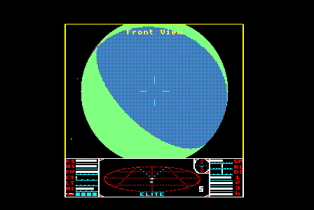
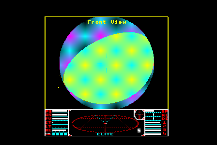
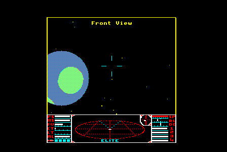
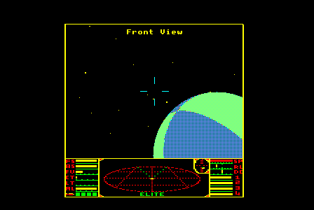

# Solid Elite for the BBC Micro

A port of Acornsoft's BBC Micro disc Elite with solid, sunlit ships and solid planets instead of wireframes, running on a BBC Micro Model B with 64K of sideways RAM. It is the BBC Micro sibling of [Solid Elite for the BBC Master](https://github.com/ebenupton/solid-elite-bbc-master) and [Solid Elite for the 6502 Second Processor](https://github.com/ebenupton/solid-elite-6502-second-processor), and, like them, it is built on, and would not exist without, [Mark Moxon](https://github.com/markmoxon)'s [fully documented source code for BBC Micro disc Elite](https://github.com/markmoxon/elite-source-code-bbc-micro-disc).

<p align="center">

<br>
<em>Lave as a beach ball: two great circles, projected exactly, split the disc into land and sea. The space view is a double-buffered four-colour screen at the 2 MHz clock; the dashboard below it is the original's, at the 1 MHz clock.</em>
</p>

What's new:

* **Solid ships, lit by the sun.** Every ship, the space station and the cargo are drawn with filled, dithered faces, shaded by the direction of the sun, as in the Master port.
* **Solid planets, drawn by one circle engine.** Every feature of a planet's surface is a circle on its sphere, projected exactly onto the disc and cut cleanly by its limb. Meridian planets, Lave's among them, are beach balls: two great circles splitting the disc into land and sea. Crater planets have up to three true spherical craters, green on a blue sea, chosen by the system's seed. Planets spin smoothly at half the original's rate, by half its angle every frame; close up, the surface is remade every frame, and in deep space every other frame.
* **Suns, near and far.** Suns are solid discs with a lens flare when you look towards them, turned down or off as the sun is hidden. Near the planet, where the original gives the sun's slot to the space station and the sun vanishes, the sun is still drawn where it would be, rising and setting behind the planet's limb.
* **Every disc incremental.** The planet and the sun keep what they drew in each screen buffer and redraw only the rows that changed, and stars never show through a fill.
* **Flicker-free, double-buffered flight, at up to 25 frames a second.** The space view is a four-colour screen (black, cyan, magenta and yellow, dithered into shades) drawn into one of two buffers in main RAM while the other is on show. Every frame is on show for at least two fields.
* **The original's dashboard, under a full-width space view.** The space view runs at the 6845's 2 MHz character clock (256 four-colour pixels a line) and the dashboard is the original Model B's, in mode 5's format at the 1 MHz clock. The video ULA's clock is switched twice a field, in mid-line, by a timer interrupt, timed to the cycle so that every horizontal sync is exactly 64 microseconds from the last ([docs/video-timing.md](docs/video-timing.md)).
* **A solid hangar** when you dock, and the Constrictor turning in solid in the mission briefing.
* **Faster game logic.** Speed-ups to the multiplication, division, square root, stardust, keyboard-scanning and line-drawing routines, rewritten for the NMOS 6502, one idea per commit. With the original's wireframe they make the game 22% faster in flight.
* **The original game, exactly.** The game logic is Acornsoft's: given the same keypresses, the port plays out the same game as the original, iteration for iteration, and its save files are byte-identical with the original's.

<p align="center">



<br>
<em>Beach-ball planets from the gate's run, in an emulated Model B (jsbeeb).</em>
</p>

## Playing it

Download [solid-elite-bbc-micro.ssd](solid-elite-bbc-micro.ssd) and run it on a BBC Micro Model B with DFS and four 16K banks of sideways RAM, or in an emulator set up that way (for example jsbeeb's "B-DFS1.2" machine, which has sideways RAM in slots 0 to 7): load the disc and press SHIFT-BREAK. The loader finds the four banks itself (the first four slots, counting down from 15, with no ROM in them and RAM that keeps what is written to it), so any sideways RAM board with four free banks will do. The game plays as BBC Micro disc Elite does: the same keys, the same saved commanders. The disc is the current build of this branch, rebuilt with every change.

So far the port has been run only in emulators. The mid-line clock switches are proved exact in jsbeeb's timing, but not yet on a real Model B; [docs/video-timing.md](docs/video-timing.md) ends with the checklist for that.

## Building it

As for Mark's source (see [his build instructions](#building-bbc-micro-disc-elite-from-the-source) below), with BeebAsm 1.11 and Python 3:

```
make
```

`make` writes the disc to `5-compiled-game-discs/elite-modelb.ssd`, copies it to `solid-elite-bbc-micro.ssd` in the root, and writes the binaries to `3-assembled-output`. If `python` or `beebasm` is not on your path, pass `PYTHON=python3` or `BEEBASM=...`. The port is the Stairway to Hell variant only, without the original's copy protection. Two options leave parts out: `make circles=off` draws the planets as plain discs, without their surfaces, and `make ssun=off` leaves out the sun near the planet. `make verify` runs the gate (below), which needs Node.js and jsbeeb (see [6-harness](6-harness/README.md)).

## The layout

The original is two programs, the flight code and the docked code, each loading the other from disc when you launch, dock or die, and each filling main RAM below the screen. The port moves both into sideways RAM and keeps the swaps: each program has a **home bank** (bank 4), paged in whenever it runs, and a **cold bank** (bank 7), reached only through far calls, and the other two banks hold the renderer (bank 5, the rasteriser; bank 6, the frame layer, the discs and the lens flare). Main RAM holds the two screen buffers (`&1000` and `&4000`), the dashboard and the split-screen interrupt above them, and the hot code that does not fit in bank 4. As in the Master port, each program's source is emitted in three passes, each in the original's order: a **low pass** of what must stay in main RAM, a **hot pass** flowed by measured sizes through main RAM and bank 4, and a **cold pass** in bank 7 for the docked screens, the text, the missions and the rest of what runs once an event. The ships' edge lists are left out (every ship is drawn from its faces), and some of the flight code's once-an-event code is loaded from disc into bank 7 as two overlays (the charts, the hyperspace jump, the launch and the escape pod; the status, market and inventory screens).

The Model B has 64K of sideways RAM against the Master's 64K plus 20K of shadow RAM, HAZEL and ANDY, so space is tight: after the planets' surfaces, 11 bytes are free at the end of bank 4, 18 in bank 7, 65 in bank 6 and 1,187 in bank 5 (1,122 of them in the row runs' 65-byte tails). The Master port's kept solid rows for docking do not fit. [docs/memory-map.md](docs/memory-map.md) has the details, and [docs/modelb-memory.md](docs/modelb-memory.md) what the MOS and DFS keep where.

## Speed

In the gate's flight run (a deterministic pilot's launch, fights, a hyperspace jump and the long approach to the next system's station, 10,000 iterations), the port runs at 7.25 main-loop iterations per emulated second, against the original's 12.64 (the original with the planet's half spin, as the comparison has it): 0.574 times its speed. Everything is drawn filled, double-buffered, on the same 2 MHz 6502 that runs the game. Most of the gap is the planets' surfaces: with plain disc planets (`make circles=off`) the port runs at 12.27, 0.970 times the original. By scene, over the same run (nearly all of it with a big planet ahead):

| Scene | Iterations | Original (wireframe) | Port | Port, `circles=off` |
|---|---:|---:|---:|---:|
| Open space | 133 | 19.48 | 13.69 | 18.97 |
| Big planet | 9,670 | 12.75 | 7.21 | 12.34 |
| Lave, just after launch | 586 | 7.91 | 5.13 | 15.67 |
| Planet close | 134 | 6.52 | 7.08 | 7.08 |

## Testing

Every commit was checked against the released game (the Stairway to Hell disc), running both side by side in an emulated Model B on the same inputs and comparing the game state at every main-loop iteration:

* **The gate** ([6-harness](6-harness/README.md), `make verify`) flies both with a deterministic pilot for 10,000 iterations and requires the game state to be the original's at every one, then docks, launches and docks again, saves, loads, fails to load and catalogues through the game's disc menu, compares the saved file byte for byte with the one the original saves, and changes views in flight. The speed-ups were each checked routine by routine against the original's on every input or a large random sample (`test_routines.py`), the rasteriser primitive by primitive against a pixel-exact model (`test_raster.py`), and the frame layer and the planets' surfaces on their own (`test_frame.py`).
* **Every horizontal sync, exactly 64 microseconds.** `bhsync.mjs` logs every horizontal sync of an instrumented headless jsbeeb through the gate's run and the screens and views, millions of them, and requires every interval to be 128 cycles and every field 312 lines; fault injection (an interrupt held off by up to 300 cycles) leaves every interval at 128, and builds with a switch moved a cycle or two outside its two-cycle window fail it.
* **Patches to the original in the comparison.** The original runs unchanged but for three things the harness does to it: at the altitude check, `Q` is set to 0 in both runs (the original takes a square root of whatever the last routine left there); an explosion's first random number takes C = 1, as the port's code leaves it; and the planet turns by its own pitch and roll by half the original's angle, worked out exactly as the port works out its half spin. With these the whole game state, the planet's vectors included, matches at every iteration.
* **Soak tests** with Dom Pajak's [elite-agent](https://github.com/8bitkick/elite-agent) playing the original while the port replays the same inputs read for read, comparing the game state at every iteration and the dashboard byte for byte ([6-harness/agentplay](6-harness/agentplay/README.md)). The last soak, on the build before the planet's records were last changed, ran 58 sessions and 1.35 million iterations with no difference: both missions, fuel and cargo scooping, all eight galaxies, witchspace, the escape pod, energy bomb, E.C.M., missiles and docking computer, every docked screen and the disc menu, and 76 deaths. Its predecessor found the one port bug the soaks have turned up, a hang after every death, since fixed.

## Credits

* **Elite** was written by **Ian Bell and David Braben** and is copyright &copy; Acornsoft 1984.

* **The source code this port is built on** is **Mark Moxon**'s reconstruction of BBC Micro disc Elite from a disassembly of the original binaries, with every line documented and explained. The commentary is copyright &copy; Mark Moxon. His work made this port possible: the memory map, the speed-ups and the renderer were all worked out from his annotated source, and his build, which reproduces the released game byte for byte, is what every change here was checked against. See his [elite.bbcelite.com](https://elite.bbcelite.com) for the full story of how Elite works.

* Mark in turn credits Paul Brink's annotated disassembly and Kieran Connell's [BeebAsm version](https://github.com/kieranhj/elite-beebasm); see his acknowledgements below.

* **The port** (the changes on this branch) is by Eben Upton, written with [Claude Code](https://claude.com/claude-code). Its renderer and many of its speed-ups come from [Solid Elite for the BBC Master](https://github.com/ebenupton/solid-elite-bbc-master).

* **Regression testing** used **Dom Pajak**'s [elite-agent](https://github.com/8bitkick/elite-agent), a rule-based Elite player, whose play drives the soak tests.

This is an independent project. It is not affiliated with or endorsed by Mark Moxon, Ian Bell, David Braben or Acornsoft, and problems with the port should be reported here, not to Mark.

The copyright position is unchanged from Mark's repository: the original game and Mark's commentary are copyright, and, as with Mark's repository, no licence is granted (see [his note on licences](#user-content-a-note-on-licences-copyright-etc) below).

## The port

The port is a series of commits on top of Mark's source, in three parts:

1. **The memory map.** Both programs move out of main RAM into sideways RAM, two banks each, swapped from disc at the same moments as the original swapped them, leaving main RAM below the screen and two banks for a renderer. The game is still the original, iteration for iteration and pixel for pixel: 11.87 flight iterations per emulated second against the original's 11.85.
2. **The speed-ups.** The game logic made faster one idea per commit, still drawing the original's wireframe pixel for pixel: 14.51 flight iterations per emulated second (1.224 times the original).
3. **The filled renderer.** The Master port's renderer, rewritten for the NMOS 6502 and the Model B's memory: filled ships lit by the sun, a double-buffered four-colour screen, disc planets and suns drawn incrementally, the sun near the planet, the lens flare, the hangar and the briefing's ship; the original's dashboard at the 1 MHz clock below the space view; then the planets' surfaces, with the Master port's faster circle arithmetic and the planet's half spin. The gate's flight run gives 7.25 iterations per emulated second (0.574 times the original with the same half spin), or 12.27 (0.970 times) with plain disc planets.

Throughout, the game logic is the original's: the port's game state matches the release at every iteration, and save files are byte-identical with the original's. See [docs/README.md](docs/README.md) for the step-by-step results, [docs/renderer.md](docs/renderer.md) for the renderer, [docs/speedups.md](docs/speedups.md) for the speed-ups, [docs/memory-map.md](docs/memory-map.md) for the layout and [docs/video-timing.md](docs/video-timing.md) for the split screen's timing.

---

## Mark Moxon's README

The rest of this file is Mark's README for the repository this port is built on, unchanged.

# Fully documented source code for the disc version of Elite on the BBC Micro

<details>
<summary>Links to my other software archaeology repositories</summary>
<hr>

**Elite sources:** [BBC Micro (cassette)](https://github.com/markmoxon/elite-source-code-bbc-micro-cassette) | [BBC Micro (disc)](https://github.com/markmoxon/elite-source-code-bbc-micro-disc) | [Elite Demonstration Disc](https://github.com/markmoxon/elite-demo-source-code-bbc-micro) | [Acorn Electron](https://github.com/markmoxon/elite-source-code-acorn-electron) | [6502 Second Processor](https://github.com/markmoxon/elite-source-code-6502-second-processor) | [Commodore 64](https://github.com/markmoxon/elite-source-code-commodore-64) | [Apple II](https://github.com/markmoxon/elite-source-code-apple-ii) | [BBC Master](https://github.com/markmoxon/elite-source-code-bbc-master) | [NES](https://github.com/markmoxon/elite-source-code-nes)

**Elite hacks:** [Elite-A](https://github.com/markmoxon/elite-a-source-code-bbc-micro) | [Two-player Elite](https://github.com/markmoxon/elite-two-player-6502-second-processor) | [Teletext Elite](https://github.com/markmoxon/teletext-elite) | [Elite 3D](https://github.com/markmoxon/elite-3d) | [Elite Universe Editor](https://github.com/markmoxon/elite-universe-editor) | [Flicker-free Commodore 64 Elite](https://github.com/markmoxon/c64-elite-flicker-free) | [Elite over Econet](https://github.com/markmoxon/elite-over-econet) | [!EliteNet](https://github.com/markmoxon/elite-over-econet-acorn-archimedes)

**Elite Compendium:** [BBC Master](https://github.com/markmoxon/elite-compendium-bbc-master) | [BBC Micro](https://github.com/markmoxon/elite-compendium-bbc-micro) | [BBC Micro B+](https://github.com/markmoxon/elite-compendium-bbc-micro-b-plus) | [Acorn Electron](https://github.com/markmoxon/elite-compendium-acorn-electron)

**Other sources:** [Aviator (BBC Micro)](https://github.com/markmoxon/aviator-source-code-bbc-micro) | [Revs (BBC Micro)](https://github.com/markmoxon/revs-source-code-bbc-micro) | [The Sentinel (BBC Micro)](https://github.com/markmoxon/the-sentinel-source-code-bbc-micro) | [Lander (Acorn Archimedes)](https://github.com/markmoxon/lander-source-code-acorn-archimedes)

**Other repositories:** [Scripts for generating bbcelite.com](https://github.com/markmoxon/bbcelite-scripts) | [Static content for bbcelite.com](https://github.com/markmoxon/bbcelite-websites) | [Elite source code library](https://github.com/markmoxon/elite-source-code-library) | [Elite Universe Editor library](https://github.com/markmoxon/elite-universe-editor-library) | [Elite over Econet file server menu](https://github.com/markmoxon/elite-over-econet-file-server-menu)

See [my profile](https://github.com/markmoxon) for more repositories to explore.
<hr>
</details>


This repository contains source code for the disc version of Ian Bell and David Braben's classic game Elite on the BBC Micro, with every single line documented and (for the most part) explained. It has been reconstructed by hand from a disassembly of the original game binaries.

It is a companion to the [elite.bbcelite.com website](https://elite.bbcelite.com).

See the [introduction](#introduction) for more information, or jump straight into the [documented source code](1-source-files/main-sources).

## Contents

* [Introduction](#introduction)

* [Acknowledgements](#acknowledgements)

  * [A note on licences, copyright etc.](#user-content-a-note-on-licences-copyright-etc)

* [Browsing the source in an IDE](#browsing-the-source-in-an-ide)

* [Folder structure](#folder-structure)

* [Flicker-free Elite](#flicker-free-elite)

* [BBC Micro Elite with music](#bbc-micro-elite-with-music)

* [BBC Micro Elite on the BBC Master](#bbc-micro-elite-on-the-bbc-master)

* [Elite Compendium](#elite-compendium)

* [Elite over Econet](#elite-over-econet)

* [Building BBC Micro disc Elite from the source](#building-bbc-micro-disc-elite-from-the-source)

  * [Requirements](#requirements)
  * [Windows](#windows)
  * [Mac and Linux](#mac-and-linux)
  * [Build options](#build-options)
  * [Updating the checksum scripts if you change the code](#updating-the-checksum-scripts-if-you-change-the-code)
  * [Verifying the output](#verifying-the-output)
  * [Log files](#log-files)
  * [Auto-deploying to the b2 emulator](#auto-deploying-to-the-b2-emulator)

* [Building different variants of the disc version of Elite](#building-different-variants-of-the-disc-version-of-elite)

  * [Building the Stairway to Hell variant](#building-the-stairway-to-hell-variant)
  * [Building the Ian Bell disc variant](#building-the-ian-bell-disc-variant)
  * [Building the sideways RAM variant](#building-the-sideways-ram-variant)
  * [Differences between the variants](#differences-between-the-variants)

## Introduction

This repository contains source code for the disc version of Elite on the BBC Micro, with every single line documented and (for the most part) explained.

You can build the fully functioning game from this source. [Three variants](#building-different-variants-of-the-disc-version-of-elite) are currently supported: the disc version from Ian Bell's personal website, the disc version from the Stairway to Hell archive, and the unreleased sideways RAM variant from Ian Bell's personal website.

This repository is a companion to the [elite.bbcelite.com website](https://elite.bbcelite.com), which contains all the code from this repository, but laid out in a much more human-friendly fashion. The links at the top of this page will take you to repositories for the other versions of Elite that are covered by this project.

* If you want to browse the source and read about how Elite works under the hood, you will probably find [the website](https://elite.bbcelite.com) a better place to start than this repository.

* If you would rather explore the source code in your favourite IDE, then the [annotated source](1-source-files/main-sources) is what you're looking for. It contains the exact same content as the website, so you won't be missing out (the website is generated from the source files, so they are guaranteed to be identical). You might also like to read the section on [browsing the source in an IDE](#browsing-the-source-in-an-ide) for some tips.

* If you want to build BBC Micro disc Elite from the source on a modern computer, to produce a working game disc that can be loaded into a BBC Micro or an emulator, then you want the section on [building BBC Micro disc Elite from the source](#building-bbc-micro-disc-elite-from-the-source)).

My hope is that this repository and the [accompanying website](https://elite.bbcelite.com) will be useful for those who want to learn more about Elite and what makes it tick. It is provided on an educational and non-profit basis, with the aim of helping people appreciate one of the most iconic games of the 8-bit era.

## Acknowledgements

BBC Micro Elite was written by Ian Bell and David Braben and is copyright &copy; Acornsoft 1984.

The code on this site has been reconstructed from a disassembly of the version released on [Ian Bell's personal website](http://www.elitehomepage.org/).

The commentary is copyright &copy; Mark Moxon. Any misunderstandings or mistakes in the documentation are entirely my fault.

Huge thanks are due to the original authors for not only creating such an important piece of my childhood, but also for releasing the source code for us to play with; to Paul Brink for his annotated disassembly; and to Kieran Connell for his [BeebAsm version](https://github.com/kieranhj/elite-beebasm), which I forked as the original basis for this project. You can find more information about this project in the [accompanying website's project page](https://elite.bbcelite.com/about_site/about_this_project.html).

Thanks to the Bitshifters for their help in building the [musical version of BBC Micro Elite](#bbc-micro-elite-with-music), and in particular Kieran Connell, Simon Morris and Negative Charge for the music player and ported music files.

The following archive from Ian Bell's personal website forms the basis for this project:

* [BBC Elite, disc version](http://www.elitehomepage.org/archive/a/a4100000.zip)

### A note on licences, copyright etc.

This repository is _not_ provided with a licence, and there is intentionally no `LICENSE` file provided.

According to [GitHub's licensing documentation](https://docs.github.com/en/free-pro-team@latest/github/creating-cloning-and-archiving-repositories/licensing-a-repository), this means that "the default copyright laws apply, meaning that you retain all rights to your source code and no one may reproduce, distribute, or create derivative works from your work".

The reason for this is that my commentary is intertwined with the original source code for Elite, and the original source code is copyright. The whole site is therefore covered by default copyright law, to ensure that this copyright is respected.

Under GitHub's rules, you have the right to read and fork this repository... but that's it. No other use is permitted, I'm afraid.

My hope is that the educational and non-profit intentions of this repository will enable it to stay hosted and available, but the original copyright holders do have the right to ask for it to be taken down, in which case I will comply without hesitation. I do hope, though, that along with the various other disassemblies and commentaries of this source, it will remain viable.

## Browsing the source in an IDE

If you want to browse the source in an IDE, you might find the following useful.

* The most interesting files are in the [main-sources](1-source-files/main-sources) folder:

  * The main game's source code is in the [elite-source-flight.asm](1-source-files/main-sources/elite-source-flight.asm) and [elite-source-docked.asm](1-source-files/main-sources/elite-source-docked.asm) files (for when we're in-flight or docked) - this is the motherlode and probably contains all the stuff you're interested in.

  * The game's loader is in the [elite-loader1.asm](1-source-files/main-sources/elite-loader1.asm), [elite-loader2.asm](1-source-files/main-sources/elite-loader2.asm) and [elite-loader3.asm](1-source-files/main-sources/elite-loader3.asm) files - these are mainly concerned with setup and copy protection.

* It's probably worth skimming through the [notes on terminology and notations](https://elite.bbcelite.com/terminology/) on the accompanying website, as this explains a number of terms used in the commentary, without which it might be a bit tricky to follow at times (in particular, you should understand the terminology I use for multi-byte numbers).

* The accompanying website contains [a number of "deep dive" articles](https://elite.bbcelite.com/deep_dives/), each of which goes into an aspect of the game in detail. Routines that are explained further in these articles are tagged with the label `Deep dive:` and the relevant article name.

* There are loads of routines and variables in Elite - literally hundreds. You can find them in the source files by searching for the following: `Type: Subroutine`, `Type: Variable`, `Type: Workspace` and `Type: Macro`.

* If you know the name of a routine, you can find it by searching for `Name: <name>`, as in `Name: SCAN` (for the 3D scanner routine) or `Name: LL9` (for the ship-drawing routine).

* The entry point for the [main game code](1-source-files/main-sources/elite-source-docked.asm) is routine `TT170`, which you can find by searching for `Name: TT170`. If you want to follow the program flow all the way from the title screen around the main game loop, then you can find a number of [deep dives on program flow](https://elite.bbcelite.com/deep_dives/) on the accompanying website.

* The source code is designed to be read at an 80-column width and with a monospaced font, just like in the good old days.

I hope you enjoy exploring the inner workings of BBC Elite as much as I have.

## Folder structure

There are five main folders in this repository, which reflect the order of the build process.

* [1-source-files](1-source-files) contains all the different source files, such as the main assembler source files, image binaries, fonts, boot files and so on.

* [2-build-files](2-build-files) contains build-related scripts, such as the checksum, encryption and crc32 verification scripts.

* [3-assembled-output](3-assembled-output) contains the output from the assembly process, when the source files are assembled and the results processed by the build files.

* [4-reference-binaries](4-reference-binaries) contains the correct binaries for each variant, so we can verify that our assembled output matches the reference.

* [5-compiled-game-discs](5-compiled-game-discs) contains the final output of the build process: an SSD disc image that contains the compiled game and which can be run on real hardware or in an emulator.

## Flicker-free Elite

This repository also includes a flicker-free version, which incorporates the backported flicker-free ship-drawing routines from the BBC Master, as well as a fix for planets so they no longer flicker. The flicker-free code is in a separate branch called `flicker-free`, and apart from the code differences for reducing flicker, this branch is identical to the main branch and the same build process applies.

The annotated source files in the `flicker-free` branch contain both the original Acornsoft code and all of the modifications for flicker-free Elite, so you can look through the source to see exactly what's changed. Any code that I've removed from the original version is commented out in the source files, so when they are assembled they produce the flicker-free binaries, while still containing details of all the modifications. You can find all the diffs by searching the sources for `Mod:`.

The repository also includes a variant that incorporates both the flicker-free ship-drawing routines and a fix for planets so they no longer flicker, though this version only works when running on a BBC Master. The flicker-free code is in a separate branch called `bbc-master-flicker-free`.

For more information on flicker-free Elite, see the [hacks section of the accompanying website](https://elite.bbcelite.com/hacks/flicker-free_elite/).

## BBC Micro Elite with music

This repository also includes a version of BBC Micro Elite that includes the music from the Commodore 64 version. The music-specific code is in a separate branch called `music`, and apart from the code differences for adding the music, this branch is identical to the main branch and the same build process applies.

The annotated source files in the `music` branch contain both the original Acornsoft code and all of the modifications for the musical version of Elite, so you can look through the source to see exactly what's changed. Any code that I've removed from the original version is commented out in the source files, so when they are assembled they produce the music-enabled binaries, while still containing details of all the modifications. You can find all the diffs by searching the sources for `Mod:`.

The music itself is built as a sideways ROM using the code in the [elite-music repository](https://github.com/markmoxon/elite-music/).

For more information on the music, see the [hacks section of the accompanying website](https://elite.bbcelite.com/hacks/bbc_elite_with_music/).

## BBC Micro Elite on the BBC Master

This repository also includes a version of BBC Micro disc Elite that will run on a BBC Master (unlike the original, which crashes when loaded into a Master). The BBC Master version is in a separate branch called `bbc-master`, and apart from the code differences for supporting the Master, this branch is identical to the main branch and the same build process applies.

The annotated source files in the `bbc-master` branch contain both the original Acornsoft code and all of the modifications required to make BBC Micro Elite run on the Master, so you can look through the source to see exactly what's changed. Any code that I've removed from the original version is commented out in the source files, so when they are assembled they produce the Master-compatible binaries, while still containing details of all the modifications. You can find all the diffs by searching the sources for `Mod:`.

The repository also includes a variant of the BBC Master version that incorporates both the flicker-free ship-drawing routines and a fix for planets so they no longer flicker. The flicker-free code is in a separate branch called `bbc-master-flicker-free`.

For more information on the port to the BBC Master, see the [hacks section of the accompanying website](https://elite.bbcelite.com/hacks/bbc_master_disc_elite/).

## Elite Compendium

This repository also includes a version of BBC Micro disc Elite for the Elite Compendium, which incorporates all the available hacks in one game. The Compendium versions are in separate branches called `elite-compendium-bbc-master` and `elite-compendium-bbc-micro`, which are included in the [Elite Compendium (BBC Master)](https://github.com/markmoxon/elite-compendium-bbc-master) and [Elite Compendium (BBC Micro)](https://github.com/markmoxon/elite-compendium-bbc-micro) repositories as submodules.

The annotated source files in the `elite-compendium` branch contain both the original Acornsoft code and all of the modifications for the Elite Compendium, so you can look through the source to see exactly what's changed. Any code that I've removed from the original version is commented out in the source files, so when they are assembled they produce the Compendium binaries, while still containing details of all the modifications. You can find all the diffs by searching the sources for `Mod:`.

For more information on the Elite Compendium, see the [hacks section of the accompanying website](https://elite.bbcelite.com/hacks/elite_compendium/).

## Elite over Econet

This repository also includes a version of BBC Micro disc Elite that loads over Econet and supports multiplayer scoreboards. The Elite over Econet version is in a separate branch called `econet`, which is included in the [Elite over Econet](https://github.com/markmoxon/elite-over-econet) repository as a submodule.

The annotated source files in the `econet` branch contain both the original Acornsoft code and all of the modifications for Elite over Econet, so you can look through the source to see exactly what's changed. Any code that I've removed from the original version is commented out in the source files, so when they are assembled they produce the Elite over Econet binaries, while still containing details of all the modifications. You can find all the diffs by searching the sources for `Mod:`.

For more information on Elite over Econet, see the [hacks section of the accompanying website](https://elite.bbcelite.com/hacks/elite_over_econet/).

## Building BBC Micro disc Elite from the source

Builds are supported for both Windows and Mac/Linux systems. In all cases the build process is defined in the `Makefile` provided.

### Requirements

You will need the following to build BBC Micro disc Elite from the source:

* BeebAsm, which can be downloaded from the [BeebAsm repository](https://github.com/stardot/beebasm). Mac and Linux users will have to build their own executable with `make code`, while Windows users can just download the `beebasm.exe` file.

* Python. The build process has only been tested on 3.x, but 2.7 might work.

* Mac and Linux users may need to install `make` if it isn't already present (for Windows users, `make.exe` is included in this repository).

For details of how the build process works, see the [build documentation on bbcelite.com](https://elite.bbcelite.com/about_site/building_elite.html).

Let's look at how to build BBC Micro disc Elite from the source.

### Windows

For Windows users, there is a batch file called `make.bat` which you can use to build the game. Before this will work, you should edit the batch file and change the values of the `BEEBASM` and `PYTHON` variables to point to the locations of your `beebasm.exe` and `python.exe` executables. You also need to change directory to the repository folder (i.e. the same folder as `make.bat`).

All being well, entering the following into a command window:

```
make.bat
```

will produce a file called `elite-disc-sth.ssd` in the `5-compiled-game-discs` folder that contains the Stairway to Hell variant, which you can then load into an emulator, or into a real BBC Micro using a device like a Gotek.

### Mac and Linux

The build process uses a standard GNU `Makefile`, so you just need to install `make` if your system doesn't already have it. If BeebAsm or Python are not on your path, then you can either fix this, or you can edit the `Makefile` and change the `BEEBASM` and `PYTHON` variables in the first two lines to point to their locations. You also need to change directory to the repository folder (i.e. the same folder as `Makefile`).

All being well, entering the following into a terminal window:

```
make
```

will produce a file called `elite-disc-sth.ssd` in the `5-compiled-game-discs` folder that contains the Stairway to Hell variant, which you can then load into an emulator, or into a real BBC Micro using a device like a Gotek.

### Build options

By default the build process will create a typical Elite game disc with a standard commander and verified binaries. There are various arguments you can pass to the build to change how it works. They are:

* `variant=<name>` - Build the specified variant:

  * `variant=sth` (default)
  * `variant=ib-disc`
  * `variant=sideways-ram`

* `commander=max` - Start with a maxed-out commander (specifically, this is the test commander file from the original source, which is almost but not quite maxed-out)

* `encrypt=no` - Disable encryption and checksum routines

* `match=no` - Do not attempt to match the original game binaries (i.e. omit workspace noise)

* `fix-interlace=yes` - By default the game forces interlace to be on, which can cause issues with some monitors and video scalers; this option uses the interlace setting from when the game is run, so you can switch interlace off before running the game with a `*TV 0,1` command, or you can enable it with `*TV 0,0`

* `verify=no` - Disable crc32 verification of the game binaries

So, for example:

`make variant=ib-disc commander=max encrypt=no match=no verify=no`

will build an unencrypted version of the variant from Ian Bell's website, with a maxed-out commander, no workspace noise and no crc32 verification.

The unencrypted version should be more useful for anyone who wants to make modifications to the game code. As this argument produces unencrypted files, the binaries produced will be quite different to the binaries on the original source disc, which are encrypted.

See below for more on the verification process.

### Updating the checksum scripts if you change the code

If you change the source code in any way, you may break the game; if so, it will typically hang at the loading screen, though in some versions it may hang when launching from the space station.

To fix this, you may need to update some of the hard-coded addresses in the checksum script so that they match the new addresses in your changed version of the code. See the comments in the [elite-checksum.py](2-build-files/elite-checksum.py) script for details.

### Verifying the output

The default build process prints out checksums of all the generated files, along with the checksums of the files from the original sources. You can disable verification by passing `verify=no` to the build.

The Python script `crc32.py` in the `2-build-files` folder does the actual verification, and shows the checksums and file sizes of both sets of files, alongside each other, and with a Match column that flags any discrepancies. If you are building an unencrypted set of files then there will be lots of differences, while the encrypted files should mostly match (see the Differences section below for more on this).

The binaries in the `4-reference-binaries` folder are those extracted from the released version of the game, while those in the `3-assembled-output` folder are produced by the build process. For example, if you don't make any changes to the code and build the project with `make`, then this is the output of the verification process:

```
Results for variant: sth
[--originals--]  [---output----]
Checksum   Size  Checksum   Size  Match  Filename
-----------------------------------------------------------
a9ee9d74  17437  a9ee9d74  17437   Yes   D.CODE.bin
dad7d3a3  17437  dad7d3a3  17437   Yes   D.CODE.unprot.bin
9f4a04fd   2560  9f4a04fd   2560   Yes   D.MOA.bin
d9eb34f9   2560  d9eb34f9   2560   Yes   D.MOB.bin
93fe2e13   2560  93fe2e13   2560   Yes   D.MOC.bin
64e8ebb4   2560  64e8ebb4   2560   Yes   D.MOD.bin
80afbff9   2560  80afbff9   2560   Yes   D.MOE.bin
b86fe100   2560  b86fe100   2560   Yes   D.MOF.bin
72f99614   2560  72f99614   2560   Yes   D.MOG.bin
29b6ce81   2560  29b6ce81   2560   Yes   D.MOH.bin
0eeab415   2560  0eeab415   2560   Yes   D.MOI.bin
7911181d   2560  7911181d   2560   Yes   D.MOJ.bin
851d789f   2560  851d789f   2560   Yes   D.MOK.bin
3025e5d8   2560  3025e5d8   2560   Yes   D.MOL.bin
d6c01098   2560  d6c01098   2560   Yes   D.MOM.bin
6930e1c7   2560  6930e1c7   2560   Yes   D.MON.bin
43caddc7   2560  43caddc7   2560   Yes   D.MOO.bin
ac1d57b2   2560  ac1d57b2   2560   Yes   D.MOP.bin
c73d535a    256  c73d535a    256   Yes   ELITE2.bin
17eefeec   2816  17eefeec   2816   Yes   ELITE3.bin
ec04b4d2   5376  ec04b4d2   5376   Yes   ELITE4.bin
10417c14   5376  10417c14   5376   Yes   ELITE4.unprot.bin
0f9e270b    256  0f9e270b    256   Yes   MISSILE.bin
42f42f63  19997  42f42f63  19997   Yes   T.CODE.bin
8819c78b  19997  8819c78b  19997   Yes   T.CODE.unprot.bin
52bac547   1024  52bac547   1024   Yes   WORDS.bin
-             -  fbf74546    883    -    MNUCODE.bin
-             -  3c56d637   1024    -    SCREEN.bin
```

All the compiled binaries match the originals, so we know we are producing the same final game as the Stairway to Hell variant.

### Log files

During compilation, details of every step are output in a file called `compile.txt` in the `3-assembled-output` folder. If you have problems, it might come in handy, and it's a great reference if you need to know the addresses of labels and variables for debugging (or just snooping around).

### Auto-deploying to the b2 emulator

For users of the excellent [b2 emulator](https://github.com/tom-seddon/b2), you can include the build parameter `b2` to automatically load and boot the assembled disc image in b2. The b2 emulator must be running for this to work.

For example, to build, verify and load the game into b2, you can do this on Windows:

```
make.bat all b2
```

or this on Mac/Linux:

```
make all b2
```

If you omit the `all` target then b2 will start up with the results of the last successful build.

Note that you should manually choose the correct platform in b2 (I intentionally haven't automated this part to make it easier to test across multiple platforms).

## Building different variants of the disc version of Elite

This repository contains the source code for two different variants of the disc version of Elite:

* The variant from the Stairway to Hell archive

* The variant from the game disc on Ian Bell's website

* The sideways RAM variant from Ian Bell's website

By default the build process builds the Stairway to Hell variant, but you can build a specified variant using the `variant=` build parameter.

### Building the Stairway to Hell variant

You can add `variant=sth` to produce the `elite-disc-sth.ssd` file containing the Stairway to Hell variant, though that's the default value so it isn't necessary. In other words, you can build it like this:

```
make.bat variant=sth
```

or this on a Mac or Linux:

```
make variant=sth
```

This will produce a file called `elite-disc-sth.ssd` in the `5-compiled-game-discs` folder that contains the Stairway to Hell variant.

The verification checksums for this version are as follows:

```
Results for variant: sth
[--originals--]  [---output----]
Checksum   Size  Checksum   Size  Match  Filename
-----------------------------------------------------------
a9ee9d74  17437  a9ee9d74  17437   Yes   D.CODE.bin
dad7d3a3  17437  dad7d3a3  17437   Yes   D.CODE.unprot.bin
9f4a04fd   2560  9f4a04fd   2560   Yes   D.MOA.bin
d9eb34f9   2560  d9eb34f9   2560   Yes   D.MOB.bin
93fe2e13   2560  93fe2e13   2560   Yes   D.MOC.bin
64e8ebb4   2560  64e8ebb4   2560   Yes   D.MOD.bin
80afbff9   2560  80afbff9   2560   Yes   D.MOE.bin
b86fe100   2560  b86fe100   2560   Yes   D.MOF.bin
72f99614   2560  72f99614   2560   Yes   D.MOG.bin
29b6ce81   2560  29b6ce81   2560   Yes   D.MOH.bin
0eeab415   2560  0eeab415   2560   Yes   D.MOI.bin
7911181d   2560  7911181d   2560   Yes   D.MOJ.bin
851d789f   2560  851d789f   2560   Yes   D.MOK.bin
3025e5d8   2560  3025e5d8   2560   Yes   D.MOL.bin
d6c01098   2560  d6c01098   2560   Yes   D.MOM.bin
6930e1c7   2560  6930e1c7   2560   Yes   D.MON.bin
43caddc7   2560  43caddc7   2560   Yes   D.MOO.bin
ac1d57b2   2560  ac1d57b2   2560   Yes   D.MOP.bin
c73d535a    256  c73d535a    256   Yes   ELITE2.bin
17eefeec   2816  17eefeec   2816   Yes   ELITE3.bin
ec04b4d2   5376  ec04b4d2   5376   Yes   ELITE4.bin
10417c14   5376  10417c14   5376   Yes   ELITE4.unprot.bin
0f9e270b    256  0f9e270b    256   Yes   MISSILE.bin
42f42f63  19997  42f42f63  19997   Yes   T.CODE.bin
8819c78b  19997  8819c78b  19997   Yes   T.CODE.unprot.bin
52bac547   1024  52bac547   1024   Yes   WORDS.bin
-             -  fbf74546    883    -    MNUCODE.bin
-             -  3c56d637   1024    -    SCREEN.bin
```

### Building the Ian Bell disc variant

You can build the Ian Bell disc variant by appending `variant=ib-disc` to the `make` command, like this on Windows:

```
make.bat variant=ib-disc
```

or this on a Mac or Linux:

```
make variant=ib-disc
```

This will produce a file called `elite-disc-ib-disc.ssd` in the `5-compiled-game-discs` folder that contains the Ian Bell disc variant.

The verification checksums for this version are as follows:

```
Results for variant: ib-disc
[--originals--]  [---output----]
Checksum   Size  Checksum   Size  Match  Filename
-----------------------------------------------------------
7b8eceb7   1418  -             -    -    !BOOT.bin
25be225d  17437  25be225d  17437   Yes   D.CODE.bin
56876c8a  17437  56876c8a  17437   Yes   D.CODE.unprot.bin
9f4a04fd   2560  9f4a04fd   2560   Yes   D.MOA.bin
d9eb34f9   2560  d9eb34f9   2560   Yes   D.MOB.bin
93fe2e13   2560  93fe2e13   2560   Yes   D.MOC.bin
64e8ebb4   2560  64e8ebb4   2560   Yes   D.MOD.bin
80afbff9   2560  80afbff9   2560   Yes   D.MOE.bin
b86fe100   2560  b86fe100   2560   Yes   D.MOF.bin
72f99614   2560  72f99614   2560   Yes   D.MOG.bin
29b6ce81   2560  29b6ce81   2560   Yes   D.MOH.bin
0eeab415   2560  0eeab415   2560   Yes   D.MOI.bin
7911181d   2560  7911181d   2560   Yes   D.MOJ.bin
851d789f   2560  851d789f   2560   Yes   D.MOK.bin
3025e5d8   2560  3025e5d8   2560   Yes   D.MOL.bin
d6c01098   2560  d6c01098   2560   Yes   D.MOM.bin
6930e1c7   2560  6930e1c7   2560   Yes   D.MON.bin
43caddc7   2560  43caddc7   2560   Yes   D.MOO.bin
ac1d57b2   2560  ac1d57b2   2560   Yes   D.MOP.bin
86e4a1ef    256  c73d535a    256   No    ELITE2.bin
fd788d2a   2304  17eefeec   2816   No    ELITE3.bin
7abce0df   5376  74278df9   5376   No    ELITE4.bin
10417c14   5376  8862453f   5376   No    ELITE4.unprot.bin
e51c9eae    256  -             -    -    ELITE5.bin
e99072dc    256  -             -    -    ELITE6.bin
0f9e270b    256  0f9e270b    256   Yes   MISSILE.bin
6b22a971  19997  6b22a971  19997   Yes   T.CODE.bin
a1cf4199  19997  a1cf4199  19997   Yes   T.CODE.unprot.bin
52bac547   1024  52bac547   1024   Yes   WORDS.bin
-             -  fbf74546    883    -    MNUCODE.bin
-             -  3c56d637   1024    -    SCREEN.bin
```

The failed matches are because I haven't yet converted the loader into BeebAsm source files (see the next section for details).

### Building the sideways RAM variant

You can build the sideways RAM variant by appending `variant=sideways-ram` to the `make` command, like this on Windows:

```
make.bat variant=sideways-ram
```

or this on a Mac or Linux:

```
make variant=sideways-ram
```

This will produce a file called `elite-disc-sideways-ram.ssd` in the `5-compiled-game-discs` folder that contains the sideways RAM variant.

The verification checksums for this version are as follows:

```
Results for variant: sideways-ram
[--originals--]  [---output----]
Checksum   Size  Checksum   Size  Match  Filename
-----------------------------------------------------------
5917731b  17437  5917731b  17437   Yes   D.CODE.bin
5917731b  17437  5917731b  17437   Yes   D.CODE.unprot.bin
9f4a04fd   2560  9f4a04fd   2560   Yes   D.MOA.bin
d9eb34f9   2560  d9eb34f9   2560   Yes   D.MOB.bin
93fe2e13   2560  93fe2e13   2560   Yes   D.MOC.bin
64e8ebb4   2560  64e8ebb4   2560   Yes   D.MOD.bin
80afbff9   2560  80afbff9   2560   Yes   D.MOE.bin
b86fe100   2560  b86fe100   2560   Yes   D.MOF.bin
72f99614   2560  72f99614   2560   Yes   D.MOG.bin
29b6ce81   2560  29b6ce81   2560   Yes   D.MOH.bin
0eeab415   2560  0eeab415   2560   Yes   D.MOI.bin
7911181d   2560  7911181d   2560   Yes   D.MOJ.bin
851d789f   2560  851d789f   2560   Yes   D.MOK.bin
3025e5d8   2560  3025e5d8   2560   Yes   D.MOL.bin
d6c01098   2560  d6c01098   2560   Yes   D.MOM.bin
6930e1c7   2560  6930e1c7   2560   Yes   D.MON.bin
43caddc7   2560  43caddc7   2560   Yes   D.MOO.bin
ac1d57b2   2560  ac1d57b2   2560   Yes   D.MOP.bin
f1c2e0e6   5376  f1c2e0e6   5376   Yes   ELITE4.bin
5a89086e   5376  5a89086e   5376   Yes   ELITE4.unprot.bin
4f2febe4    256  4f2febe4    256   Yes   MISSILE.bin
fbf74546    883  fbf74546    883   Yes   MNUCODE.bin
3c56d637   1024  3c56d637   1024   Yes   SCREEN.bin
201036b2  19997  201036b2  19997   Yes   T.CODE.bin
201036b2  19997  201036b2  19997   Yes   T.CODE.unprot.bin
52bac547   1024  52bac547   1024   Yes   WORDS.bin
-             -  c73d535a    256    -    ELITE2.bin
-             -  17eefeec   2816    -    ELITE3.bin
```

### Differences between the variants

You can see the differences between the variants by searching the source code for `_STH_DISC` (for features in the Stairway to Hell variant), `_IB_DISC` (for features in the Ian Bell game disc variant) or `_SRAM_DISC` (for features in the sideways RAM variant). There are only a few differences between the Ian Bell variant and the others:

* The Ian Bell variant contains the refund bug, which has been fixed in the other variants

* The Ian Bell variant never spawns asteroids, which has been fixed in the other variants

* The Ian Bell variant sets bit 2 of the competition flag in the commander file, while the other variants set bit 5

In other words, the Ian Bell variant appears to be the very first release of the disc version of Elite, while the Stairway to Hell and sideways RAM variants have both bugs fixed and a bumped-up number in the competition flag.

The sideways RAM variant has the following extra features:

* All ship blueprints are available in sideways RAM at the same time, so all ship types can appear at any time without the restrictions of the disc version's blueprint files, and loading is quicker on launch and there is no disc access at all when hyperspacing

* The missile blueprint is the version from the non-disc versions

* The scanner shows the space station, asteroids, escape pods and cargo in red, as opposed to the yellow/green of the original

* Different parts of the copy protection are disabled compared to the other variants

* The main docked and flight binaries in T.CODE and D.CODE are not encrypted

* The sideways RAM loader is a mod in the true sense, in that it works with the normal disc version, converting it to work with sideways RAM

See the [accompanying website](https://elite.bbcelite.com/disc/releases.html) for a comprehensive list of differences between the variants.

Note that I have only included differences that appear in the main game code, rather than those that appear in the loaders, as these files can differ extensively between variants without affecting the game itself. The variant on Ian Bell's personal website contains a whole load of copy protection differences when compared to the same code in the Stairway to Hell variant, and it also contains two more binary files (`ELITE5` and `ELITE6`), plus a `!BOOT` file that contains even more copy protection code. I haven't disassembled the loader files from this variant as that's a whole different rabbit hole, so if you build the Ian Bell variant with `make`, the compiled loader binaries will not match those extracted from the original disc. The main binaries will match, however, which is the interesting part from a digital archaeology perspective, as that's where the bug fixes live.

---

Right on, Commanders!

_Mark Moxon_